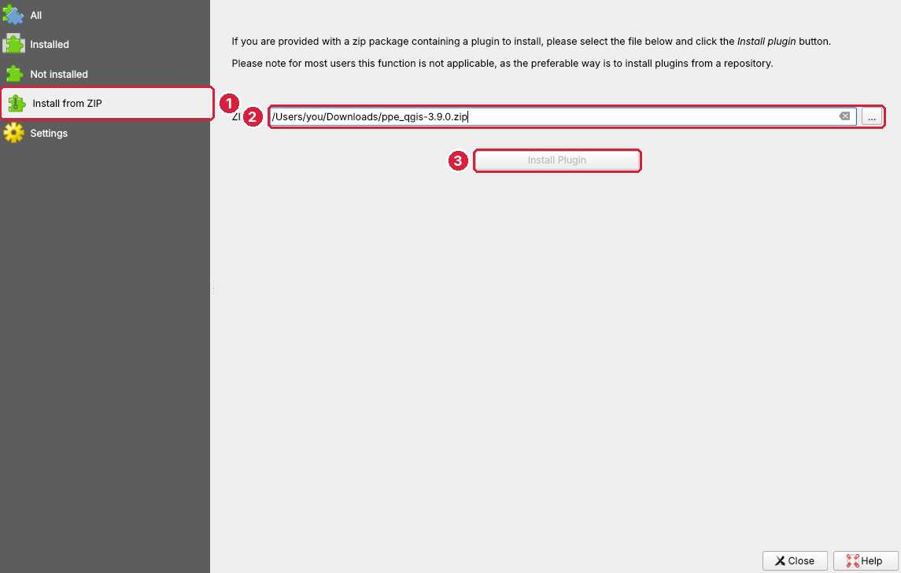
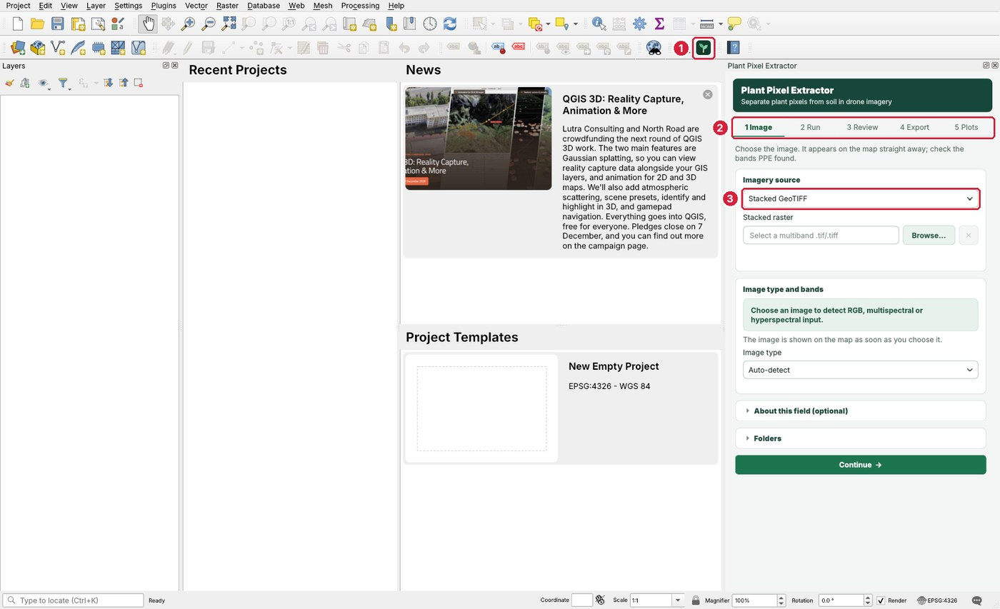
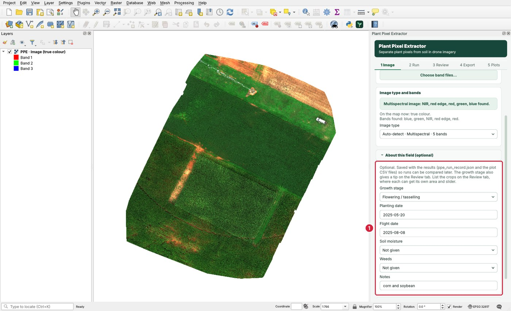
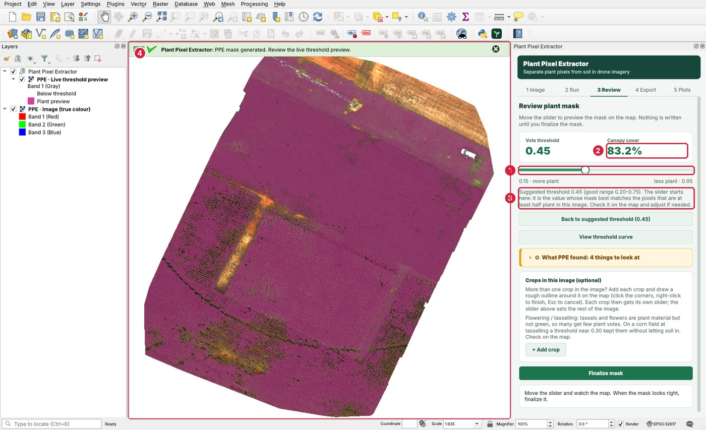
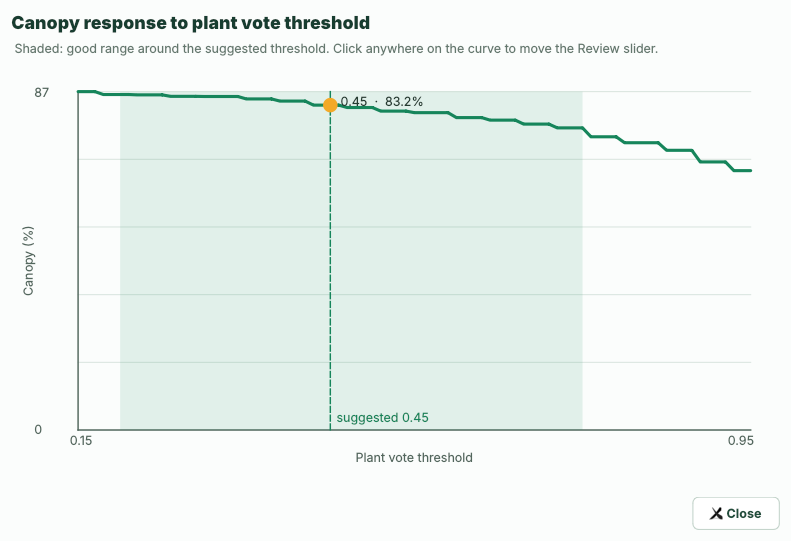
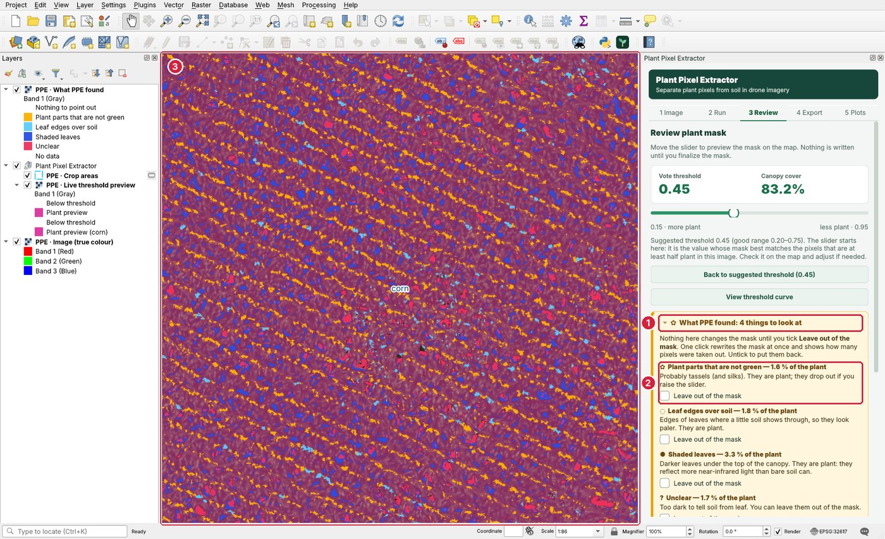
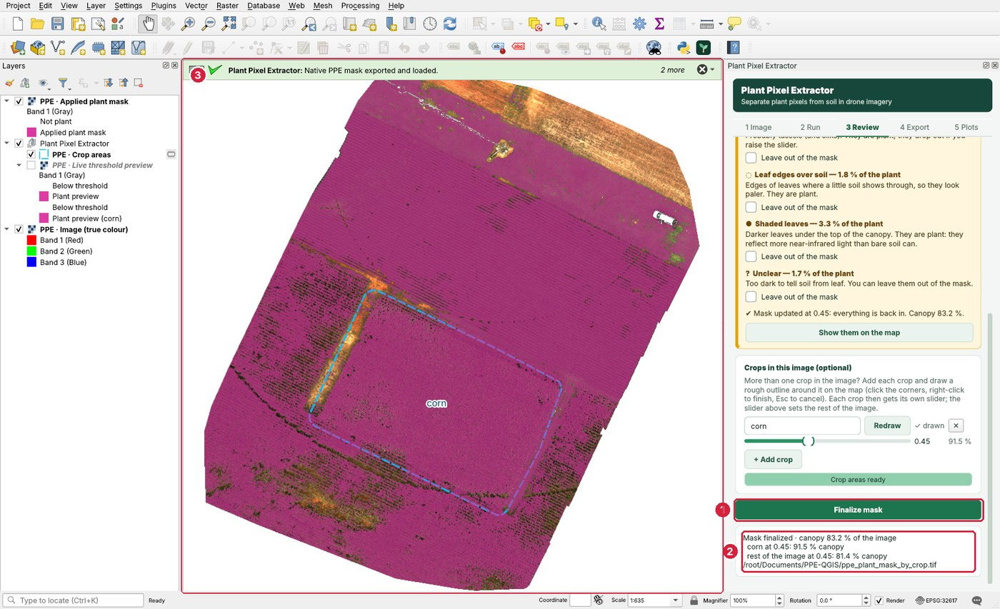
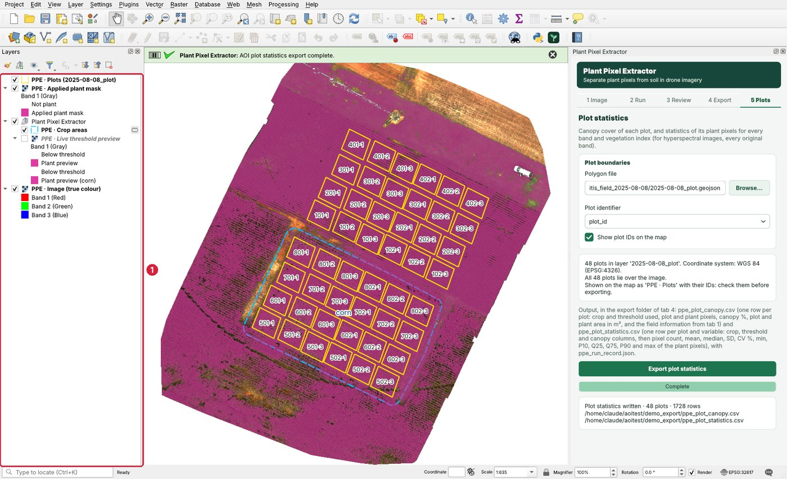

# Plant Pixel Extractor (PPE) for QGIS

PPE separates plant pixels from soil in drone orthomosaics, with no training data. It works with RGB cameras, multispectral sensors (MicaSense, Parrot Sequoia, DJI and others) and hyperspectral cubes. It runs inside QGIS using only the GDAL and NumPy that ship with QGIS, so there is nothing else to install.

**What you get:** a plant mask you can check on the map before it is written, canopy cover for the whole field, for each crop and for each plot, plant-only bands and vegetation indices, and statistics of the plant pixels in every plot.

**How it works, in one paragraph.** PPE ranks the vegetation indices the image allows by how well they spread plant from soil. It splits the three best with four automatic thresholds (Otsu, CDF knee, k-means and multi-Otsu), and the twelve results vote. A pixel's vote is the share of those twelve that call it plant. Guards then remove shadows, algae on wet soil and grey objects. You choose the vote threshold with a live slider; for images with a NIR band PPE suggests one.

The screenshots below are from a real run in QGIS 3.34 on a five-band multispectral image of a corn and soybean field (9371 × 10056 pixels). Red numbers in each picture match the numbered notes under it.

---

## Contents

1. [Install](#1-install)
2. [Open PPE](#2-open-ppe)
3. [Tab 1 Image: choose the image](#3-tab-1-image-choose-the-image)
4. [Tab 2 Run: build the plant vote](#4-tab-2-run-build-the-plant-vote)
5. [Tab 3 Review: choose the threshold](#5-tab-3-review-choose-the-threshold)
6. [Several crops in one image (optional)](#6-several-crops-in-one-image-optional)
7. [What PPE found: tassels, leaf edges, shade](#7-what-ppe-found-tassels-leaf-edges-shade)
8. [Finalize the mask](#8-finalize-the-mask)
9. [Tab 4 Export: plant-only rasters](#9-tab-4-export-plant-only-rasters)
10. [Tab 5 Plots: canopy and statistics per plot](#10-tab-5-plots-canopy-and-statistics-per-plot)
11. [The Layers panel](#11-the-layers-panel)
12. [Files PPE writes](#12-files-ppe-writes)
13. [Tips and troubleshooting](#13-tips-and-troubleshooting)

---

## 1. Install

You need **QGIS 3.28 or newer** (Windows, macOS or Linux).

**From the QGIS plugin repository** (once approved): **Plugins → Manage and Install Plugins → All**, search for **Plant Pixel Extractor**, click **Install Plugin**.

**From a ZIP file** (from the [releases page](https://github.com/Leoanish/ppe-qgis/releases), or built with `./build_plugin.sh`):



1. **Plugins → Manage and Install Plugins**, then **Install from ZIP** on the left.
2. Choose `ppe_qgis-3.9.0.zip` with the **…** button.
3. **Install Plugin**.

When you update to a newer version, quit QGIS and open it again afterwards, so the new code is loaded.

## 2. Open PPE



1. Click the **leaf button** in the toolbar, or choose **Raster → Plant Pixel Extractor**. The PPE panel opens on the right; you can drag it wider or float it.
2. The **five tabs** are used from left to right: Image, Run, Review, Export, Plots.
3. **Imagery source**: how your image is stored. Choose one of the following:
   - *Stacked GeoTIFF*: one file holding every band;
   - *Folder containing bands*: one file per band in a folder;
   - *Individual band files*: pick each band file.

## 3. Tab 1 Image: choose the image

**A folder of band files.** When you choose a folder, PPE lists its raster files:


1. **Tick** the files that are bands of this image. Files PPE recognised start ticked. Thermal files, stacked files and files it could not recognise start unticked, and the *Note* column says why.
2. **Band**: the band PPE read from the file name, the band name inside the file or its wavelength. Change it if it is wrong (for example `IMG_0001_4.tif`).
3. **Use the ticked files**. PPE imports exactly those. **Choose band files…** opens the list again later.

**The image appears on the map at once**, before anything is analysed:


1. The chosen folder (or file).
2. **The bands PPE found**, and the image type it detected (RGB, multispectral or hyperspectral). Check this line: it decides which indices PPE can use.
3. The map shows the image as follows:
   - in **true colour** (red, green and blue share one stretch, so colours look natural) when it has red, green and blue;
   - otherwise in false colour (NIR, red, green), or the NIR band in grey.

**About this field (optional).** Nothing here changes the mask; it is saved with the results so runs can be compared later.



1. Fill in what you know:
   - growth stage, planting and flight dates, soil moisture, weeds and notes;
   - at *Flowering / tasselling* or *Drying down* the Review tab adds a threshold tip.

**Folders** (closed by default) sets where results and temporary files go. The defaults work; change them if you want results next to your data.

## 4. Tab 2 Run: build the plant vote


1. **Run**. PPE reads the image, ranks the indices, runs the four thresholds on the top three and builds the vote. It works in the background, so QGIS stays usable.


1. The progress bar names the current step. **Cancel** stops the run. The 9371 × 10056 five-band field took about 20 seconds on a 2-core computer; PPE limits its memory use to a quarter of the RAM.

When the run finishes, PPE opens the Review tab.

## 5. Tab 3 Review: choose the threshold



1. **Vote threshold slider.** A pixel is plant when at least this share of the votes call it plant. Drag it and watch the map: lower keeps more (paler plants, edges), higher keeps less. Nothing is written yet.
2. **Canopy cover** at the current threshold, updated as you drag.
3. **Suggested threshold** for this image, with a good range. For images with a NIR band, PPE estimates the threshold whose mask best matches the pixels that are at least half plant, from the image's own pure-plant and pure-soil spectra. The slider starts there; **Back to suggested threshold** returns to it.
4. **Live preview** of the plant mask in magenta, drawn over the image.

**View threshold curve** shows canopy cover at every threshold, with the suggestion and its good range marked. Click on the curve to move the slider there.



A flat stretch of the curve means the mask hardly changes there: any threshold in it gives the same canopy. A steep part means the threshold matters, so check the map carefully there.

## 6. Several crops in one image (optional)

Different crops, or the same crop at a different stage, can need different thresholds. Under **Crops in this image** on the Review tab:


1. **+ Add crop**, type its name, then **Draw area**. While you draw, the button turns grey and reads **Drawing…**, and the other crops wait.
2. Click the corners of a **rough outline** around that crop on the map. Right-click (or double-click) to finish; Esc cancels; Backspace removes the last corner.


1. Each drawn crop gets **its own slider and canopy**; the main slider sets the rest of the image (headlands, roads). *Use the slider above for every crop* moves them together.
2. The outline is shown as **PPE · Crop areas**. **Redraw** replaces it; **✕** removes the crop.

Only the threshold differs between areas; the vote itself is the same, so a crop slider at the main slider's value gives exactly the usual mask.

## 7. What PPE found: tassels, leaf edges, shade

After each run PPE sorts out four kinds of pixel worth a look. Each is judged from the image's own typical green leaf and its bare soil in sun, and from where the pixel sits; nothing is guessed from the crop name.

| Kind | What it is |
|---|---|
| ✿ **Plant parts that are not green** | as much near-infrared light as plant, but not leaf-green, inside closed canopy: tassels, flowers, heads, pods, yellowing leaves |
| ◌ **Leaf edges over soil** | the same colour, but next to soil: a little soil in the pixel makes a leaf edge look pale |
| ● **Shaded leaves** | darker than half a typical leaf, but more near-infrared light than sunlit soil can reflect: leaves under the top of the canopy |
| ? **Unclear** | as dark, but no more near-infrared light than soil: could be deep shade on a leaf or on soil |



1. Open the closed card **What PPE found: n things to look at**.
2. Each kind present shows its share of the plant and one plain sentence.
3. **Show them on the map** adds *PPE · What PPE found*: plant parts amber, leaf edges light blue, shaded leaves blue, unclear red. Here, the tassels lie along the corn rows.

**Leave a kind out of the mask, or put it back, with one click:**


1. Tick **Leave out of the mask**. PPE rewrites the mask at once (finalizing it if needed); you stay on the Review tab.
2. The card reports what was taken out, counted in the new mask file, for example *919,515 pixels left out (unclear). Canopy 83.2 % → 81.8 %*.
3. The map shows the **applied mask**, and the left-out pixels are now holes. The live preview is switched off for this, because it would fill them in; moving a slider switches it on again.

Untick, or **Put all back**, to return them. The mask is always rebuilt from the vote, so nothing is lost either way. Each choice is written to its own file (for example `ppe_plant_mask_0.45_without_unclear.tif`), and the plot export and run record say what was left out.

Nothing is judged when leaves and soil hardly differ in near-infrared light, or without red and NIR bands; the log says why.

## 8. Finalize the mask



1. **Finalize mask** writes the plant mask at full resolution (1 = plant, 0 = not plant).
2. The status gives the canopy of the image and of each crop, and the mask file's path.
3. *PPE · Applied plant mask* is added to the map.

You can go back, move the slider and finalize again at any time; the vote is kept.

## 9. Tab 4 Export: plant-only rasters


1. **Export folder**.
2. Choose what to write:
   - **Export plant-only bands**: every band with soil set to NoData;
   - **Export plant-only vegetation indices**: every index the image allows;
   - **Export bands and all indices**: both.

Each raster is a GeoTIFF on the original pixel grid. Exporting all indices of a large image can take time and disk space; PPE asks first.

## 10. Tab 5 Plots: canopy and statistics per plot


1. **Polygon file** with your plots. PPE accepts:
   - a Shapefile (choose the `.shp` or any of its side files) or a zipped Shapefile;
   - GeoPackage, GeoJSON, KML/KMZ, GML, FlatGeobuf or SpatiaLite.
   Plots in another coordinate system are reprojected to the image.
2. **Plot identifier**: the field that names each plot (PPE suggests `plot_id`, `plot`, `id` or `name`).
3. PPE says **how many plots lie over the image**. Check this before exporting: no plots over the image usually means a missing `.prj` file.
4. **Export plot statistics**.
5. The plots are shown as **PPE · Plots**, yellow outlines labelled with their IDs. Untick *Show plot IDs on the map* to hide the labels.

The export writes two CSV files into the export folder.

**`ppe_plot_canopy.csv`** has one row per plot. Its columns:
- `crop` and `threshold` used there;
- `plot_pixels`, `plant_pixels` and `canopy_pct`;
- `plot_area_m2` and `plant_area_m2`;
- the What PPE found shares (`plant_parts_pct`, `leaf_edges_pct`, `shaded_leaves_pct`, `unclear_pct`) and `left_out_of_mask`;
- the field information from tab 1.

```
plot_id,crop,threshold,plot_pixels,plant_pixels,canopy_pct,plot_area_m2,plant_area_m2,plant_parts_pct,...
402-3,,0.45,296744,296670,99.98,62.91,62.89,0.01,...
```

**`ppe_plot_statistics.csv`** has one row per plot and variable (every band and index). It holds the canopy columns, then, for the plant pixels only: `pixel_count`, `mean`, `median`, `sd`, `cv_pct`, `min`, `p10`, `q25`, `q75`, `p90` and `max`. Percentiles follow R's default (type 7), so they match the `ppe` R package.

## 11. The Layers panel



1. PPE's results are layers of their own, kept in this order from the top:
   - **PPE · Plots**;
   - **PPE · What PPE found** (when shown);
   - **PPE · Applied plant mask**;
   - the **Plant Pixel Extractor** group, holding only the working layers (*Crop areas*, *Live threshold preview*);
   - **PPE · Image**.

   Your own layers keep their places. Removing the PPE image layer resets PPE; removing the live preview switches the slider off until the next run. Every layer can be restyled like any QGIS layer.

## 12. Files PPE writes

The output and working folders are set under **Folders** on tab 1; plot results go to the export folder of tab 4.

| File | What it is |
|---|---|
| `ppe_plant_mask_<threshold>.tif` | the finalized mask (1 plant, 0 not plant, 255 no data); `_by_crop` with crop areas, `_without_<kinds>` when kinds were left out |
| `ppe_run_record.json` | what was done, so the result can be repeated: image, chosen indices, suggestion, thresholds, canopy per crop, what was left out, field information |
| `ppe_plot_canopy.csv`, `ppe_plot_statistics.csv` | plot results (tab 5) |
| plant-only band and index GeoTIFFs | tab 4 |
| run folder `ppe_YYYYMMDD_HHMMSS` (in the working folder) | the vote raster, `ppe_findings.tif` (What PPE found), the true-colour display image and guard rasters (which pixels each guard removed) |
| `logs/ppe_YYYYMMDD_HHMMSS.log` (in the output folder) | the log of each run: attach it when you report a problem |

## 13. Tips and troubleshooting

- **The mask misses pale plants or flowers.** Lower the threshold a little, or draw that crop as its own area with a lower threshold. At tasselling, a corn field kept its tassels near 0.30 without letting soil in.
- **Shaded leaves or dark gaps.** Open *What PPE found*. Shaded leaves are plant; unclear pixels can be left out with one tick and put back.
- **Wrong bands.** Check tab 1's *bands found* line, and for folders, the Band column of the band-files dialog.
- **No plots over the image.** The plot file has no coordinate system (a Shapefile without `.prj`) or is in the wrong place.
- **Errors** always name the step, the kind of error and the log file. Report problems at <https://github.com/Leoanish/ppe-qgis/issues> with the log, the QGIS version, the sensor and the raster size.

## For developers

- Plugin source and the full reference guide: [`ppe_qgis/README.md`](ppe_qgis/README.md)
- Version history: `changelog` in [`ppe_qgis/metadata.txt`](ppe_qgis/metadata.txt)
- Unit tests: `tests/` (run from the repository root with `python -m unittest discover -s tests`; needs GDAL and NumPy)
- Build the ZIP for QGIS: `./build_plugin.sh`

## License

GNU General Public License, version 2 or later. See [`LICENSE`](LICENSE).

Author: Anish Bhattarai, University of Georgia.
