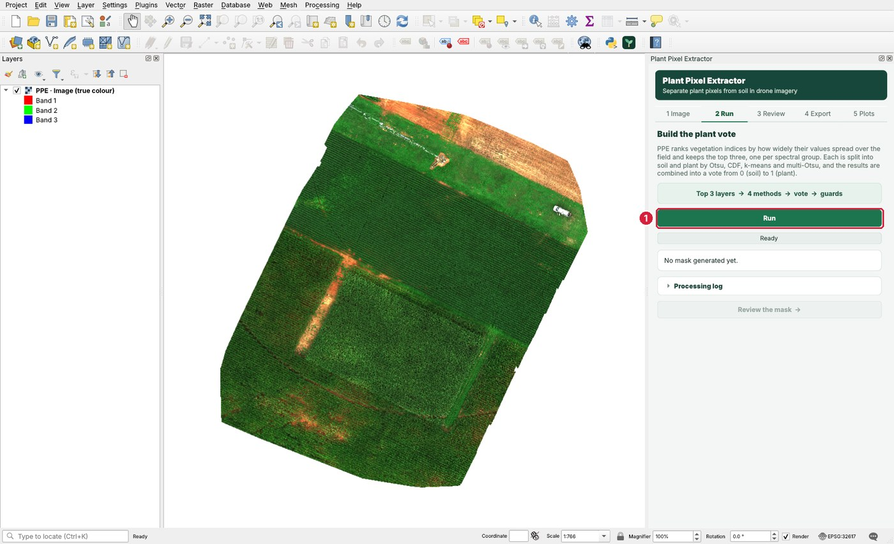
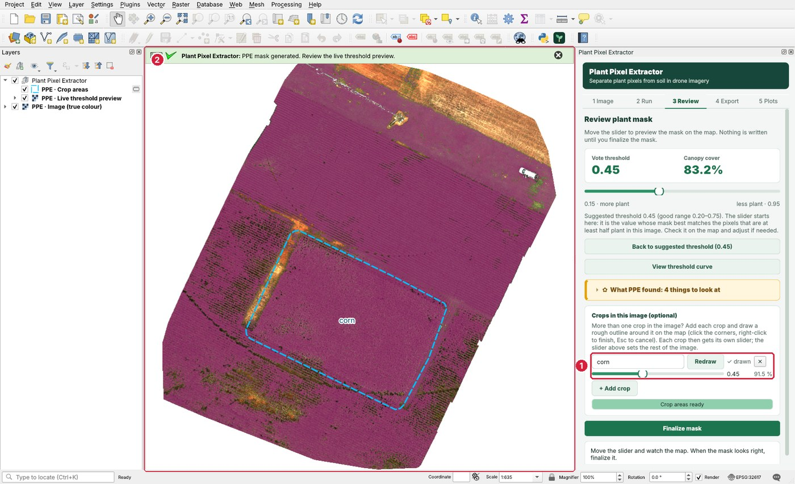
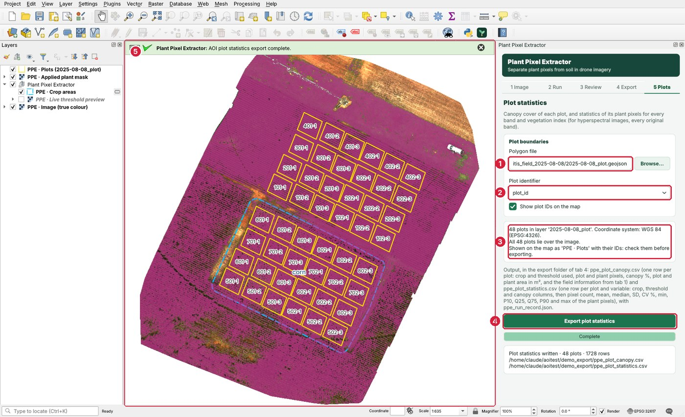
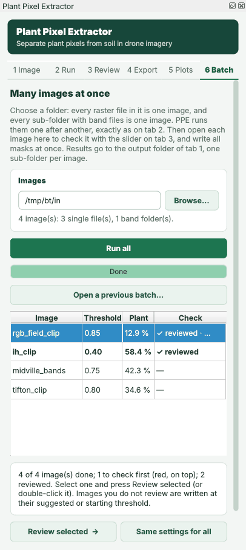

# Plant Pixel Extractor (PPE) for QGIS

[](https://github.com/Leoanish/ppe-qgis/actions/workflows/checks.yml)

PPE separates plant pixels from soil in drone orthomosaics, with no training data. It works with RGB cameras, multispectral sensors (MicaSense, Parrot Sequoia, DJI and others) and hyperspectral cubes. It runs inside QGIS using only the GDAL and NumPy that ship with QGIS, so there is nothing else to install.

**What you get:** a plant mask you can check on the map before it is written, canopy cover for the whole field, for each crop and for each plot, plant-only bands and vegetation indices, and statistics of the plant pixels in every plot. Two more goals use the same mask: a **plant count** you can correct on the map (early season, per image and per plot) and **training data** for a fast plant/soil model, with no hand labelling.

**How it works, in one paragraph.** PPE ranks the vegetation indices the image allows by how well they spread plant from soil. It splits the three best with four automatic thresholds (Otsu, CDF knee, k-means and multi-Otsu), and the twelve results vote. A pixel's vote is the share of those twelve that call it plant. Guards then remove shadows, algae on wet soil and grey objects. You choose the vote threshold with a live slider; for images with a NIR band PPE suggests one.

**New in 4.12.1:** the plant count summary comes in short sections (counted, not counted, check first, how PPE measured, files); the Review tab says while PPE looks for weeds in the background and what it found; long touching patches split faster.

**New in 4.11.1** (all changes since 4.5.2):

- **Weeds in What PPE found**: after every run PPE lists weeds between and inside the crop rows. Click any plant on the map to mark it weed or crop, then leave the weeds out for a clean plant-only mask ([section 7](#7-what-ppe-found-tassels-leaf-edges-shade-dry-leaves-sparse-spots-weeds)).
- **Crop-only mask** from the checked plant count ([section 12](#12-goal-plant-counter-count-plants)).
- **Weeds are never labelled as plant** in Create labels and Training data; weeds can be a label class of their own ([section 14](#14-goal-create-labels-plant-and-soil-points-for-your-own-model)).
- **Plant counter for crop rows**: plant spacing, automatic split of touching plants, Merge and Split tools.
- **Faster and lighter** (same results), and **ready for QGIS 4**: works on QGIS 3.28 to 4.x.

The screenshots below are from a real run in QGIS 3.34 on a five-band multispectral image of a corn and soybean field (9371 × 10056 pixels). Red numbers in each picture match the numbered notes under it.

---

## Contents

1. [Install](#1-install)
2. [Open PPE](#2-open-ppe)
3. [Tab 1 Image: choose the image](#3-tab-1-image-choose-the-image)
4. [Tab 2 Run: build the plant vote](#4-tab-2-run-build-the-plant-vote)
5. [Tab 3 Review: choose the threshold](#5-tab-3-review-choose-the-threshold)
6. [Several crops in one image (optional)](#6-several-crops-in-one-image-optional)
7. [What PPE found: tassels, leaf edges, shade, dry leaves, sparse spots, weeds](#7-what-ppe-found-tassels-leaf-edges-shade-dry-leaves-sparse-spots-weeds)
8. [Finalize the mask](#8-finalize-the-mask)
9. [Tab 4 Export: plant-only rasters](#9-tab-4-export-plant-only-rasters)
10. [Tab 5 Plots: canopy and statistics per plot](#10-tab-5-plots-canopy-and-statistics-per-plot)
11. [Tab 6 Batch: many images at once](#11-tab-6-batch-many-images-at-once)
12. [Goal Plant counter: count plants](#12-goal-plant-counter-count-plants)
13. [Goal Training data: tiles and labels for a model](#13-goal-training-data-tiles-and-labels-for-a-model)
14. [Goal Create labels: plant and soil points for your own model](#14-goal-create-labels-plant-and-soil-points-for-your-own-model)
15. [The Layers panel](#15-the-layers-panel)
16. [Files PPE writes](#16-files-ppe-writes)
17. [Tips and troubleshooting](#17-tips-and-troubleshooting)

---

## 1. Install

You need **QGIS 3.28 or newer, including QGIS 4** (Windows, macOS or Linux).

**From the QGIS plugin repository** (once approved): **Plugins → Manage and Install Plugins → All**, search for **Plant Pixel Extractor**, click **Install Plugin**.

**From a ZIP file** (from the [releases page](https://github.com/Leoanish/ppe-qgis/releases), or built with `./build_plugin.sh`):


1. **Plugins → Manage and Install Plugins**, then **Install from ZIP** on the left.
2. Choose `ppe_qgis-4.0.0.zip` with the **…** button.
3. **Install Plugin**.

When you update to a newer version, quit QGIS and open it again afterwards, so the new code is loaded.

## 2. Open PPE


1. Click the **leaf button** in the toolbar, or choose **Raster → Plant Pixel Extractor**. The PPE panel opens on the right; you can drag it wider or float it.
2. Choose the **Goal** at the top: *Plant mask* (the default), *Plant counter*, *Training data for a model* or *Create labels*. The tabs are used from left to right. Tabs 1 to 3 (Image, Run, Review) are the same for every goal; tab 4 is the goal's own step (Export, Count or Train data), and Batch is last. *Create labels* is simpler still: just tab 1 Image and tab 2 Labels. Changing the goal also tidies the map: the layers of the other goals are hidden (not deleted) and this goal's layers come back as you left them. The image stays, and your own layers are never touched. Finalize leads straight to tab 4. PPE remembers the goal. The **?** button next to the goal opens this guide at the step you are on.
3. **Imagery source**: how your image is stored. Choose one of the following:
   - *Stacked GeoTIFF*: one file holding every band;
   - *Folder containing bands*: one file per band in a folder;
   - *Individual band files*: pick each band file.

## 3. Tab 1 Image: choose the image

**A folder of band files.** When you choose a folder, PPE lists its raster files:


1. **Tick** the files that are bands of this image. Files PPE recognised start ticked. Thermal files, stacked files and files it could not recognise start unticked, and the *Note* column says why.
2. **Band**: the band PPE read from the file name, the band name inside the file or its wavelength. Change it if it is wrong (for example `IMG_0001_4.tif`).
3. **Use the ticked files**. PPE imports exactly those. **Choose band files…** opens the list again later.

**The image appears on the map at once**, before anything is analysed:


1. The chosen folder (or file).
2. **The bands PPE found**, and the image type it detected (RGB, multispectral or hyperspectral). Check this line: it decides which indices PPE can use.
3. The map shows the image as follows:
   - in **true colour** (red, green and blue share one stretch, so colours look natural) when it has red, green and blue;
   - otherwise in false colour (NIR, red, green), or the NIR band in grey.

**About this field (optional).** Nothing here changes the mask; it is saved with the results so runs can be compared later.


1. Fill in what you know:
   - growth stage, planting and flight dates, soil moisture, weeds and notes;
   - at *Flowering / tasselling* or *Drying down* the Review tab adds a threshold tip.

**Folders** (closed by default) sets where results and temporary files go. The defaults work; change them if you want results next to your data.

## 4. Tab 2 Run: build the plant vote



1. **Run PPE** (or **▶ Run PPE now** straight from tab 1). PPE reads the image, ranks the indices, runs the four thresholds on the top three and builds the vote; *How it works* on the tab explains the method. It works in the background, so QGIS stays usable.


1. The progress bar names the current step and the time left. **Cancel** stops the run. The 9371 × 10056 five-band field took about 20 seconds on a 2-core computer; PPE keeps its working memory under about 1 GB.

After the run, PPE looks for weeds between and inside the rows in the background and builds map overviews, so the mask and the slider are ready at once and large images draw fast when zoomed out; the weed kinds join *What PPE found* a few seconds later.

When the run finishes, PPE opens the Review tab.

## 5. Tab 3 Review: choose the threshold


1. **Vote threshold slider.** A pixel is plant when at least this share of the votes call it plant. Drag it and watch the map: lower keeps more (paler plants, edges), higher keeps less. Nothing is written yet.
2. **Canopy cover** at the current threshold, updated as you drag.
3. **Suggested threshold** for this image, with a good range. For images with a NIR band, PPE estimates the threshold whose mask best matches the pixels that are at least half plant, from the image's own pure-plant and pure-soil spectra. The slider starts there; **Back to suggested threshold** returns to it.
4. **Live preview** of the plant mask in magenta, drawn over the image.

**View threshold curve** shows canopy cover at every threshold, with the suggestion and its good range marked. Click on the curve to move the slider there.


A flat stretch of the curve means the mask hardly changes there: any threshold in it gives the same canopy. A steep part means the threshold matters, so check the map carefully there.

**"Plants and ground do not separate clearly."** PPE measures how clearly its top index splits the image into two groups (0 to 1). Under 0.65, the run summary, the message bar and the *What PPE found* card warn you to check the mask closely. This happens when plants are very few or tiny (seedlings) or with RGB-only images. In tests it warned on an RGB-only field and on seedling images, never on four multispectral fields or late-stage images. It is only a message: nothing in the mask changes.

## 6. Several crops in one image (optional)

Different crops, or the same crop at a different stage, can need different thresholds. Under **Crops in this image** on the Review tab:


1. **+ Add crop**, type its name, then **Draw area**. While you draw, the button turns grey and reads **Drawing…**, and the other crops wait.
2. Click the corners of a **rough outline** around that crop on the map. Right-click (or double-click) to finish; Esc cancels; Backspace removes the last corner.



1. Each drawn crop gets **its own slider and canopy**; the main slider sets the rest of the image (headlands, roads). *Use the slider above for every crop* moves them together.
2. The outline is shown as **PPE · Crop areas**. **Redraw** replaces it; **✕** removes the crop.

Only the threshold differs between areas; the vote itself is the same, so a crop slider at the main slider's value gives exactly the usual mask.

## 7. What PPE found: tassels, leaf edges, shade, dry leaves, sparse spots, weeds

After each run PPE sorts out eight kinds of pixel worth a look: seven you can leave out of the mask, and one you can add to it. Nothing is tied to a particular field or crop: every reference (the green leaves' NDVI, colour, brightness and near-infrared light, and the bare soil's) is measured on the image itself, from the pixels nearly all the voters agree on. Each check runs whenever the image has the bands it needs, and the card says which could not run and why.

| Kind | What it is |
|---|---|
| ✿ **Plant parts that are not green** | as much near-infrared light as plant, but not leaf-green, inside closed canopy: tassels, flowers, heads, pods, yellowing leaves |
| ◌ **Leaf edges over soil** | the same colour, but next to soil: a little soil in the pixel makes a leaf edge look pale |
| ● **Shaded leaves** | darker than half a typical leaf, but more near-infrared light than sunlit soil can reflect: leaves under the top of the canopy |
| ? **Unclear** | as dark, but no more near-infrared light than soil: could be deep shade on a leaf or on soil |
| ❧ **Dry or yellowing plant parts** | inside the canopy (no bare soil close by), red about as bright as green and a lower NDVI than green leaves, but more near-infrared light than sunlit soil: leaves drying or turning yellow-brown. Only pixels that can be in a mask are marked |
| ✚ **Faint plants in sparse spots** | where the canopy is thin (under 25 % plant in 3 m squares at the suggested threshold), the pixels a threshold 0.20 lower would add there: small, pale plants that get fewer votes. These are **added** to the mask when you tick them |
| ✕ **Weeds between the rows** (violet) | plants between the crop rows, smaller than a typical crop plant. PPE finds the rows and the plants behind the scenes, as the plant counter does |
| ✕ **Weeds inside the rows** (white) | small plants closer than half the plant spacing to a bigger crop plant in the row |


1. Open the closed card **What PPE found: n things to look at**.
2. Each kind present shows its share of the plant and one plain sentence. The coloured square is its colour on the map.
3. **Show them on the map** adds a group, *PPE · What PPE found*, with **one layer per kind**:
   - *Plant parts that are not green (amber)*;
   - *Leaf edges over soil (light blue)*;
   - *Shaded leaves (blue)*;
   - *Unclear (red)*;
   - *Dry or yellowing plant parts (brown)*;
   - *Faint plants in sparse spots (light green)*.

   Tick or untick each kind to see it alone or compare it with the others. All the layers read the same file, so this costs no disk space.
4. Here, the tassels lie along the corn rows.

**Leave a kind out, or add it, with one click.** Every kind has two buttons: **− Leave out** takes the pixels of that kind out of the mask, and **+ Add** puts in the pixels of that kind that the slider leaves out (the card says how much each would add). Press a button again to undo. A kind is either left out or added, never both. Faint plants in sparse spots sit below the threshold by definition, so they have only **+ Add**. A pressed button turns dark green.


1. Press **− Leave out**.
2. The card says what is left out: the kinds, their share of the plant and, without crop areas, the exact number of pixels.
3. The **live preview** drops those pixels at once; they show as holes. It is still the same live layer, and they stay out whatever you do with the slider (or the crop sliders), so you tune the threshold with them already left out.

**Finalize mask** writes the mask without them, then reports the pixels it left out (counted in the mask file) and the canopy before and after. Press the button again, or **Put all back**, to return them, then finalize again. The mask is always rebuilt from the vote, so nothing is lost either way. Each choice is written to its own file (for example `ppe_plant_mask_0.45_without_unclear.tif`), and the plot export and run record say what was left out.

Which checks run depends only on the bands: plant parts, leaf edges and dry parts need NIR, red and green; shaded leaves and unclear pixels need a brightness (red, green and blue, or NIR alone) and are told apart by NDVI; a camera RGB image gets only unclear (dark) pixels. When the near-infrared band barely separates leaves from soil (an uncalibrated band), the checks that compare near-infrared brightness are not run and NDVI decides between shaded and unclear. Faint plants in sparse spots need only the vote; when more than 30 % of the 3 m squares are thin, the whole field is thin and PPE says to move the slider instead. The card lists anything not checked.

**Add faint plants in sparse spots:**


1. If the field has thin patches, the card lists **Faint plants in sparse spots** and how much more plant they would add.
2. Press **+ Add**. The live preview shows them at once, and the canopy on the panel goes up; they stay in whatever the slider.
3. **Finalize mask** writes them into the mask (for example `ppe_plant_mask_0.80_with_sparse.tif`) and reports the pixels added.

The same **+ Add** works for every other kind: for example, add shaded leaves that a high threshold dropped, or leaf edges you count as plant. On Kritis, leaving out leaf edges and adding shaded leaves at 0.45 took 954,588 leaf-edge pixels out and put 465 shaded-leaf pixels in (canopy 83.2 % → 81.7 %).

**Weeds: review them, then leave them out.** Press **✎ Review weeds on the map** and click any plant: a weed becomes crop again, a crop plant becomes a weed (click again to undo). The card, the live preview and the map follow at once. Then press **− Leave out** on the weed kinds and **Finalize mask**. Plants cut by the edge of the image or field are never marked, and a piece bigger than 3 × a typical plant (crop joined to a weed) cannot be marked as a weed as a whole. Checking matters: on 79 PhenoBench images, PPE's weed marks left out without a check did not make the mask cleaner (crop overlap 68.3 → 68.0), while with every plant checked the weeds fell from 14.0 to 6.5 % of the mask and the crop overlap rose to 73.6.

On Tifton, compared with a reference mask over 354 cells of 3 m × 3 m, adding them at the suggested threshold raised the pixel match (IoU) from 91.3 to 91.9 %, cut the canopy error per cell from 3.4 to 2.9 points, and raised the agreement of the plant NDVI mean from R² 0.83 to 0.92 and of the median from 0.86 to 0.93. In the thin patches alone the match rose from 78 to 87 %. Bringing back faint pixels along the crop rows was also tried and did less, so rows are not used. It is not available with crop areas: lower that crop's slider instead.

## 8. Finalize the mask


1. **Finalize mask** writes the plant mask at full resolution (1 = plant, 0 = not plant).
2. The status gives the canopy of the image and of each crop, and the mask file's path.
3. *PPE · Applied plant mask* is added to the map.

Only one magenta layer is shown at a time. After Finalize the map shows the finalized mask. As soon as you move a slider or tick a kind, the live preview comes back, and the finalized mask is switched off (it stays in the Layers panel). The Export tab then tells you that its exports still use the finalized mask, until you finalize again. You can go back, change things and finalize again at any time; the vote is kept.

## 9. Tab 4 Export: plant-only rasters


1. **Export folder**.
2. Choose what to write:
   - **Export plant-only bands**: every band with soil set to NoData;
   - **Export plant-only vegetation indices**: every index the image allows;
   - **Export bands and all indices**: both.

Each raster is a GeoTIFF on the original pixel grid. Exporting all indices of a large image can take time and disk space; PPE asks first.

## 10. Tab 5 Plots: canopy and statistics per plot



1. **Polygon file** with your plots. PPE accepts:
   - a Shapefile (choose the `.shp` or any of its side files) or a zipped Shapefile;
   - GeoPackage, GeoJSON, KML/KMZ, GML, FlatGeobuf or SpatiaLite.
   Plots in another coordinate system are reprojected to the image.
2. **Plot identifier**: the field that names each plot (PPE suggests `plot_id`, `plot`, `id` or `name`).
3. PPE says **how many plots lie over the image**. Check this before exporting: no plots over the image usually means a missing `.prj` file.
4. **Export plot statistics**.
5. The plots are shown as **PPE · Plots**, yellow outlines labelled with their IDs. Untick *Show plot IDs on the map* to hide the labels.

The export writes two CSV files into the export folder.

**`ppe_plot_canopy.csv`** has one row per plot. Its columns:
- `crop` and `threshold` used there;
- `plot_pixels`, `plant_pixels` and `canopy_pct`;
- `plot_area_m2` and `plant_area_m2`;
- the What PPE found shares (`plant_parts_pct`, `leaf_edges_pct`, `shaded_leaves_pct`, `unclear_pct`, `dry_parts_pct`, `sparse_faint_pct`), `left_out_of_mask` and `added_to_mask`;
- the field information from tab 1.

```
plot_id,crop,threshold,plot_pixels,plant_pixels,canopy_pct,plot_area_m2,plant_area_m2,plant_parts_pct,...
402-3,,0.45,296744,296670,99.98,62.91,62.89,0.01,...
```

**`ppe_plot_statistics.csv`** has one row per plot and variable (every band and index). It holds the canopy columns, then, for the plant pixels only: `pixel_count`, `mean`, `median`, `sd`, `cv_pct`, `min`, `p10`, `q25`, `q75`, `p90` and `max`. Percentiles follow R's default (type 7), so they match the `ppe` R package.

## 11. Tab 6 Batch: many images at once



For many images (dates, fields or flights), PPE can run a whole folder and let you check each image with the same slider.

1. **Choose the folder.** Every raster file in it (`.tif`, `.tiff`, `.vrt`, `.img`, `.jp2`) is one image, and every sub-folder holding band files is one image. The tab says how many it found. The output and working folders are the ones set on tab 1; each image gets its own sub-folder.
2. **Run all.** The images run one after another, each exactly as on its own: same vote, suggested threshold, What PPE found, warnings and confident labels. An image that fails is listed as failed and the rest go on. **Cancel** stops after the current image; the finished ones are kept.
3. **The list.** One row per image: threshold, plant cover and checks. Images to check first (for example "plants and ground do not separate clearly") are on top in red.
4. **Review selected** (or double-click a row) opens the image on the map and shows its review right below the list: threshold, canopy cover, the slider, **Suggested**, **✓ Finalize this mask** and **Next image**. No need to leave the tab. **More on tab 3** opens What PPE found and crop tools for the same image (a banner there says which image it is). Your threshold and any kinds left out are kept for that image. In the list, ⚠ marks images to check, ✓ reviewed or ✓ mask written; hover a row for the details.
5. **Same settings for all** gives every image the threshold (and kinds left out) of the image open on tab 3.
6. **Finalize all masks** writes every mask at its own threshold into the image's folder, plus `ppe_batch_summary.csv`: image, threshold, whether you reviewed it, plant cover, what was left out, checks, mask and labels paths. Images you did not open are written at their suggested (or starting) threshold.

**Open a previous batch…** reopens a batch later from its `ppe_batch.json`, with the settings you chose (kept in `ppe_batch_choices.json`).

## 12. Goal Plant counter: count plants


Choose **Plant counter** at the top. Run and review as usual, finalize the mask, and tab 4 **Count** counts the plants.

> **For the early season only.** Count before the leaves of neighbouring plants touch or overlap. Plants whose canopies overlap merge into one patch and are counted as one, so later in the season the count is too low. The Count tab says so at the top.

- **One plant** gets one point. PPE first drops specks smaller than the **smallest plant** (in cm²; set it a little below your smallest seedling). Then pieces closer than **Join leaves closer than** (1 cm by default) become one plant: the leaves of one plant often show as separate pieces because the stem or petiole between them is thin. Keep this setting smaller than the gap between neighbouring plants.
- A plant also needs a **sure core**: at least 5 pixels where every PPE vote says plant. This keeps out soil spots that a low threshold lets in.
- **Touching plants** become one. Groups much bigger than the larger plants of the image (over 2.5 × the 75th percentile) are flagged **check** (orange). Splitting them by size made counts much worse in tests, so PPE uses the rows instead (next point).
- **Split touching plants by the plant spacing** (on by default; needs crop rows): PPE measures the distance between plants along the rows from **confident plants** only: single plants of normal size for that image (around the typical plant; the range follows how much plant sizes vary in the image), and only the gaps between two neighbouring confident plants (leaf pieces, plants cut at the image edge and oversized plants would make false short gaps; gaps over a missing plant are halved; at least 20 gaps are needed) and splits each *check* patch into *(its length along the row ÷ plant spacing)* plants, drawn green with an orange ring (**split by PPE**). A patch shorter than 1.5 spacings is one big plant and stays *check*. You can type the **plant spacing in the row** (your seeding distance) instead, for small images or when you know it. On PhenoBench (61 check patches holding 103 sugar-beet plants; spacing measured per date from many plants, as in an orthomosaic) the measured spacing was 20.7 / 19.5 / 20.6 cm against a true 22.0 / 20.2 / 21.2 cm (from all plants it was 19.2 / 17.7 / 16.3 cm), and the wrong plants in check patches fell from 52 (not split) to 27 (spacing from all plants) to 22 (confident plants). It helps little once canopies close.
- **Weeds inside the rows** (on by default; needs crop rows and the plant spacing): a plant closer than half the plant spacing to its neighbour in the row, and smaller than a typical plant of the image and than that neighbour, is most likely a weed or a stray leaf and becomes **weed?** (not counted); hover over it to see why, and switch it back if it is a crop plant. On PhenoBench (79 images, 541 sugar beet) the counted points on weeds fell from 232 to 176, the per-image count error (sum) from 258 to 200 (242 before splitting existed), and the crop plants with exactly one point rose from 61.6 to 62.7 %; it helped on every date. Plant size alone, colour (the images are RGB) and shape removed more crop plants than weeds, so they are not used. The panel says in words the plant spacing, the length above which a patch is split (1.5 × spacing) and how long each split patch was. On the map each split point is labelled with its part, for example **2/3** = part 2 of a patch split into 3 (check points show **#id**); hover for details. Check these points: ⊕ Merge makes the whole patch one plant again; ✂ Split on a split point splits only its part further.
- **Find crop rows** (on by default): PPE finds the direction and spacing of the crop rows itself, anywhere from 15 to 150 cm apart, from the plant pixels of the mask, and fits the row positions separately in each 4 m patch so plots shifted against each other still fit. Plants between the rows are marked as possible weeds (grey with a red ring) and not counted. Where rows are not clear (closed canopy, broadcast crops), nothing is marked. On our fields it found 91 cm (Tifton, Midville) and 76 cm (IH corn), and no rows on the closed Kritis canopy.
- **Area** (optional): **Draw area** lets you click an outline on the map (right-click to finish; draw several to add them together), or choose a polygon file such as the field boundary. Plants are counted only inside it: the mask outside the area is left out before counting, so field edges, headlands and weedy corners give no points, and plants per m² uses the area's own size. The area is shown as **PPE · Count area** with a solid red outline (every area drawn in PPE is red, while drawing and after), and the panel shows a green **✓ Area set** and kept as `ppe_count/ppe_count_area.gpkg`. With **Count all batch masks** the same area is used for every image.
- **Plot file** (optional): plants and plants per m² for each plot.
- **Count all batch masks** counts every mask written on the Batch tab.

How close is it? On 37 PhenoBench test images (sugar beet with weeds, every plant boxed by hand; plants smaller than 1 cm² left out), with masks at threshold 0.65, the share of plants that got exactly one point was 88 % at the seedling date, 57 % at the middle date and 50 % at the late date. Plants split into several points: 2, 6 and 5 %. Before leaves were joined (4.3.0): 72, 51 and 48 % right, with 21, 19 and 12 % split. The plants still missed later in the season are mostly plants that touch, and small weeds PPE's mask does not catch.

The points are in the layer **PPE · Plants**, kept at the top of the Layers panel. What is counted and what is not:

| Point | Meaning | Counted |
|---|---|---|
| yellow | plant | yes |
| orange | check: a patch much bigger than a typical plant; may be several touching plants | yes, as **one** (split it to count each) |
| green with an orange ring | split by PPE from the plant spacing | yes, each (check them) |
| light green | split by you | yes, each |
| blue | added by you | yes |
| grey with a red ring | possible weed: between the rows, or small and crowding a plant inside the row | **no** |

The panel says the same after every change, for example *Counted: 214 plants = 190 plant + 5 check (each as 1) + 12 split by PPE + 4 split by you + 3 added by you. Not counted: 12 possible weeds.* `ppe_count_summary.csv` has the same columns.

**Correct the count on the map.** PPE's points are a fast first count; it cannot tell every weed from the crop or separate plants that overlap, so check them and fix what is wrong:


- **＋ Add plant**: click where a plant was missed.
- **－ Remove point**: click a point that is not a plant (soil, a weed, a plant counted twice).
- **Plant ↔ weed**: click a point to switch it between plant (counted) and weed (not counted).
- **✂ Split**: click a point that holds several touching plants (orange *check* points usually do; two touching plants are often not big enough to be flagged), type how many plants you see, and PPE puts one point on each: on the thickest parts of the patch, each with its share of the pixels. The new points are light green and each is counted. PPE does not guess the number itself: on PhenoBench neither the patch size nor its shape got it right often enough. With the right number typed, the plants that got exactly one point rose from 26 to 53 % in check patches of 2 or more plants. Where leaves overlap a lot, look at the result and use **Undo last** or **＋ Add plant**.
- **⊕ Merge**: click a point that was split (by PPE or by you) and its whole patch becomes one plant again (yellow). Or click two separate points (for example one plant counted twice) to make them one. ✂ **Split** on a split point splits only that point's part (the pixels nearer to it than to the patch's other points) into the number you type; the other points stay.
- When the plant points appear, the other PPE layers (mask, votes, findings) are unticked so you see only the image and the points; tick them again in the Layers panel if you want them.
- PPE always opens on the **Plant mask** goal; choose another goal at the top when you need it.
- **Undo last** (or Backspace), and **Done** (or Esc) to stop.

Each click is saved in `ppe_plants.gpkg` at once, and the count, plants per m², `ppe_count_summary.csv` and the counts per plot are updated.

**Crop-only mask.** Once the points are checked, **Make crop-only mask (leave out the weeds)** writes `<mask>_crop_only.tif` next to the points and shows it as **PPE · Crop-only plant mask**: the plant mask without every plant piece whose points are all *weed?* or that you removed. A piece that still has a counted point stays whole. Press it again after more fixes to update it.

## 13. Goal Training data: tiles and labels for a model

Choose **Training data for a model** at the top. After a run (no need to finalize: the labels do not depend on the slider), tab 4 **Train data** cuts the image and PPE's labels into tiles:

- **plant**: every PPE vote says plant (not *unclear*; groups of at least 30 pixels);
- **soil**: no PPE vote (at most a tenth) says plant, or *unclear* (too dark to tell);
- **unsure**: the rest; models skip these pixels.

Image tiles keep every band with its original values and data type. Train and validation tiles come from different images (from different parts of the image when there is only one). **From all batch images** uses every image of the batch.

Training happens outside QGIS with `ppe_train.py` (in the plugin's `tools` folder; **Open the tools folder** shows it). It needs Python with PyTorch (`pip install torch`) and GDAL, and uses an NVIDIA GPU, an Apple chip or the CPU:

```
python ppe_train.py train   ppe_training_data                 # about 2 minutes on a laptop CPU
python ppe_train.py predict ppe_model.pt new_flight.tif       # writes new_flight_model_plant_mask.tif
python ppe_train.py check   ppe_model.pt new_flight.tif <PPE run folder of new_flight>
python ppe_train.py update  ppe_model.pt <new training data> <old training data>
```

Weeds PPE found (What PPE found, after your review) are labelled unsure (255), never plant.

**Keeping the model up to date.** Fields change through the season, so a model trained early drifts later. For each new flight, run PPE and then `check`: it compares the model with PPE's sure pixels, against how well it agreed on its own validation tiles. If it misses plants PPE is sure of, or calls PPE's sure soil plant, update it with the new images **plus** old ones. Updating with new images only makes it forget the old ones. In a test on PhenoBench, a model trained on seedlings and updated with late images alone fell from 87 to 77 % overlap on seedlings; updated with new and old images it kept 85 % and reached 96 % on the late images.

On PhenoBench (143 training images, 37 unseen test images), the model trained in 2 minutes on PPE's labels alone reached 93.6 % overlap with hand labels on the test images; the same model trained on the hand labels reached 95.4 %.

## 14. Goal Create labels: plant and soil points for your own model

For anyone who wants to train their own machine-learning model, which needs labelled plant and soil pixels. Choose **Create labels** at the top. There are only two tabs: choose the image on tab 1 and click **Continue** (or go to tab 2 **Labels**). Type how many points you want and the plant/soil split (50 % by default) and click **Create labels**. PPE runs, finalizes its mask at its own suggested threshold and places the points, all in one go (about 11 seconds on Midville, 500 points). PPE itself is unchanged.

**1 Points.** Only *clear* pixels can become a point:

- **plant**: in the finalized mask, every vote sure (at least 0.9), nothing found by PPE there (pale or dry plant parts, leaf edges, shade, unclear, faint sparse spots, **weeds**), and not on the edge of the plant. So a weed PPE found is never a plant label;
- **soil**: outside the mask, at most a tenth of the votes say plant, nothing found by PPE there, and not on the edge of the soil.

- **weed** (optional, **Label weeds as a third class**, on by default): weeds of What PPE found where every vote is sure; about a tenth of the points, on top. Untick it for a plant/soil model: weeds then get no label at all.

**Use the finalized mask on the map (with your weed review)**: when you finalized a mask in the Plant mask goal, the points come from it and from the weeds you reviewed there, instead of a new run. On the 12 weediest PhenoBench images, plant points on weeds fell from 34 to 18 % after reviewing the weeds (76 clicks); the weed points PPE placed were on weeds 81 % of the time.

Pixels near the threshold, flagged plant parts and no-data are never used. Where the points go is chosen by **conditioned Latin hypercube sampling** (cLHS), separately for plant and for soil, over every band, NDVI and the position in the field. So the points cover the whole range of the image and the whole field, not just the easiest pixels. In a test, cLHS left half as many value ranges empty as random sampling did. 500 points take about 15 seconds on a 1.5 cm, 5-band field.

**Area (optional, in step 1).** **Draw area** lets you click an outline on the map (right-click to finish; draw several to add them together), or choose a polygon file such as the field boundary or the plots. Points and buffers then stay inside it, so field edges, headlands, roads or weedy corners never give labels.

**2 Check the points.** They appear as **PPE · Label points**: green for plant, orange for soil, violet for weed. Zoom in and fix any point that is wrong with **Plant ↔ soil**, **Weed ↔ plant**, **Remove**, **＋ Plant**, **＋ Soil** or **＋ Weed**. Each click is saved and **Undo last** steps back. Points you changed or added get a white ring.

**Buffer (in step 1).** The slider (0 to 50 cm in 0.5 cm steps) grows each point into a disc. Once the points exist, the buffers are on the map as **PPE · Label buffers**: every pixel that gets a label is filled, green for plant and orange for soil. They follow the slider while you drag it (on Kritis, 500 points, each step took 0.04 s), so you see exactly which pixels will be labelled. When the points are created, PPE works out once, for every pixel a buffer can reach within 50 cm, how far it is from its point along the buffer's path; the slider then only changes which of those pixels are coloured. After you fix points (switch, add, remove), the buffers are rebuilt in the background a moment later. **Export** writes exactly the pixels shown. A buffer grows out from its point, through pixels of the point's own class only, and stays in one piece: a plant buffer follows the leaf and stops at its edge, a soil buffer stops before the canopy, and it never jumps to other leaves inside the disc. **Buffer takes in** chooses which pixels count as its class: *Sure pixels only* (default: every vote agrees and PPE found nothing unusual; most accurate, but leaves gaps where PPE is unsure) or *All pixels of its class* (every pixel of PPE's mask class, 1 pixel away from the other class; fuller). Against hand-checked points the sure pixels were right 88 to 98 % of the time and all pixels 77 to 94 %; the gap is largest on blurry images (IH: 10 cm buffers filled 53 % of the disc with sure pixels, 83 % with all pixels). As you move the slider, the panel shows how many pixels will be labelled. **Pixels per point** (optional) keeps only the nearest pixels, so one big leaf cannot dominate. A point you switched to the other class keeps only its own pixel, because PPE's mask disagrees with you there.

**3 Export.** Choose a folder (or PPE asks for one) and click **Export labels**. The folder gets:

- `ppe_labels.gpkg`: the points, with your label, PPE's label, status (proposed, changed, added) and band values;
- `ppe_label_buffers.gpkg`: one polygon per point (shown as **PPE · Label buffers**);
- `ppe_label_raster.tif`: 1 plant, 0 soil, 2 weed, 255 no label, aligned with the image;
- `ppe_label_pixels.csv`: every labelled pixel with its point, label, position, band values and NDVI, ready for a model;
- `ppe_labels_area.gpkg`: the area, when one was used.

Export again whenever you like, for example after more checks or with another buffer: the working copy stays in `ppe_labels` in the output folder.

Pixels of one buffer are alike. When you test a model, keep whole points apart (column `point_id`), not single pixels, or the accuracy looks better than it is.

On four fields (Kritis, Midville, IH, Tifton), we compared PPE's automatic labels with hand-checked points that fell on clear pixels. They agreed on 98, 97, 88 and 90 % of the points.

## 15. The Layers panel


1. PPE's results are layers of their own, kept in this order from the top:
   - **PPE · Plots**;
   - the **PPE · What PPE found** group, with one layer per kind (when shown);
   - **PPE · Applied plant mask**;
   - **PPE · Image**.
2. The **Plant Pixel Extractor** group holds only the working layers: *Crop areas* and *Live threshold preview*.

PPE's layers come in **folded**, so the panel stays short; the arrow beside a layer shows its legend. Your own layers keep their places. Removing the PPE image layer resets PPE; removing the live preview switches the slider off until the next run. Every layer can be restyled like any QGIS layer.

## 16. Files PPE writes

The output and working folders are set under **Folders** on tab 1; plot results go to the export folder of tab 4. Each image gets its own folder inside the output folder, named after the image (`<output folder>/<image name>/`, as a batch image does), so two images never overwrite each other's mask, count or labels; labels are in `<image name>/ppe_labels`.

| File | What it is |
|---|---|
| `ppe_plant_mask_<threshold>.tif` | the finalized mask (1 plant, 0 not plant, 255 no data); `_by_crop` with crop areas, `_without_<kinds>` when kinds were left out |
| `ppe_run_record.json` | what was done, so the result can be repeated: image, chosen indices, suggestion, thresholds, canopy per crop, what was left out, field information |
| `ppe_plot_canopy.csv`, `ppe_plot_statistics.csv` | plot results (tab 5) |
| plant-only band and index GeoTIFFs | tab 4 |
| run folder `ppe_YYYYMMDD_HHMMSS` (in the working folder) | the vote raster, `ppe_findings.tif` (What PPE found), the true-colour display image and guard rasters (which pixels each guard removed) |
| `ppe_batch.json`, `ppe_batch_choices.json`, `ppe_batch_summary.csv` | a batch (tab 6): its list of images, the settings you chose, and the table written by Finalize all masks |
| `ppe_confident_labels.tif` (in the run folder) | PPE's sure pixels as labels: 1 plant (every vote agrees), 0 soil (at most a tenth of the votes say plant), 255 not labelled. Use it to train your own model or to check PPE. On a public sugar beet dataset, a small model trained on these labels alone reached 94.7 % overlap with hand labels on unseen images, against 95.4 % when trained on the hand labels themselves. |
| `ppe_count/ppe_plants.gpkg`, `ppe_count_summary.csv`, `ppe_plot_counts.csv`, `ppe_batch_counts.csv` | plant count (Count tab): one point per plant, totals, counts per plot, counts per batch image |
| `ppe_training_data/` (`images/`, `labels/`, `manifest.json`, `README.txt`) | training data (Train data tab) for `ppe_train.py` |
| `logs/ppe_YYYYMMDD_HHMMSS.log` (in the output folder) | the log of each run: attach it when you report a problem |

## 17. Tips and troubleshooting

- **The mask misses pale plants or flowers.** Lower the threshold a little, or draw that crop as its own area with a lower threshold. At tasselling, a corn field kept its tassels near 0.30 without letting soil in.
- **Shaded leaves or dark gaps.** Open *What PPE found*. Shaded leaves are plant; unclear pixels can be left out with one tick and put back. On RGB-only images (no NIR) PPE tells them apart by colour: dark pixels whose strongest colour is still green are shaded leaves, the rest (mostly soil in shadow) are unclear.
- **Wrong bands.** Check tab 1's *bands found* line, and for folders, the Band column of the band-files dialog.
- **No plots over the image.** The plot file has no coordinate system (a Shapefile without `.prj`) or is in the wrong place.
- **Errors** always name the step, the kind of error and the log file. Report problems at <https://github.com/Leoanish/ppe-qgis/issues> with the log, the QGIS version, the sensor and the raster size.

## For developers

- Plugin source and the full reference guide: [`ppe_qgis/README.md`](ppe_qgis/README.md)
- Version history: `changelog` in [`ppe_qgis/metadata.txt`](ppe_qgis/metadata.txt)
- Unit tests: `tests/` (run from the repository root with `python -m unittest discover -s tests`; needs GDAL and NumPy)
- Build the ZIP for QGIS: `./build_plugin.sh`

## License

GNU General Public License, version 2 or later. See [`LICENSE`](LICENSE).

Author: Anish Bhattarai, University of Georgia.
